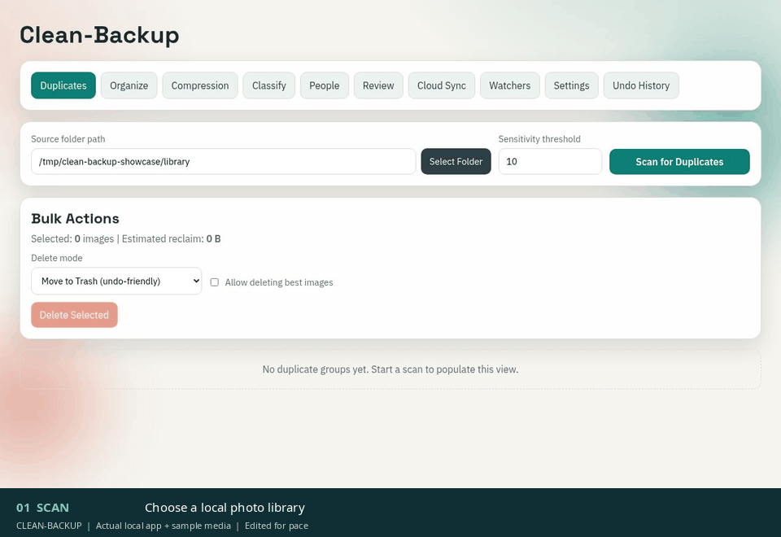
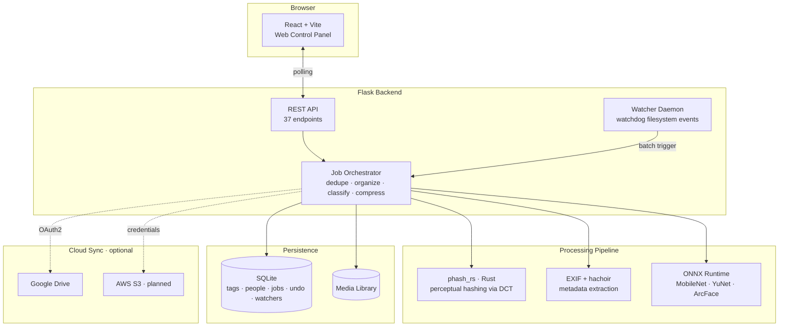

# Clean-Backup

**Intelligent media organization with perceptual deduplication, AI classification, and a hybrid Rust/Python architecture.**



*A 32-second walkthrough of the running web app: scan nine sample images, review three duplicate groups, organize copies by date, and undo the session. Actual screen captures, edited for pace. [Recording details and sample sources](docs/RECORDING.md).*

[](https://github.com/JayacharanR/Clean-Backup/actions/workflows/ci.yml)
[](https://github.com/JayacharanR/Clean-Backup/actions/workflows/release.yml)


<!-- > 🔗 **Try it live:** [demo.clean-backup.onrender.com](https://demo.clean-backup.onrender.com) — read-only sample instance, no signup required -->

---

## Overview

Your photo library is a mess — thousands of files, duplicates across devices, no organization, no backups. Clean-Backup fixes that.

It scans your media library using **perceptual hashing** (not checksums — it catches resized, re-compressed, and format-converted duplicates), organizes files by date using EXIF metadata, classifies content with on-device ML (scene recognition, face detection, face naming), and optionally syncs to the cloud. Everything runs locally — no data leaves your machine.

The performance-critical image hashing is written in **Rust** (`phash_rs`), the ML pipeline uses **ONNX Runtime** for inference, and the web control panel is **React + Flask** — all packaged in a single Docker image.

## Quickstart

Run the full stack with zero setup:

```bash
docker run -p 127.0.0.1:8080:8080 -v ~/Photos:/data/media ghcr.io/jayacharanr/clean-backup:latest
```

Then open [http://localhost:8080](http://localhost:8080).

> **Note:** The media folder is mounted read-write so the app can deduplicate and organize your files. Always have a backup.

For persistent database and config, use [`docker-compose.yml`](docker-compose.yml):

```bash
# Copy and edit the env file
cp .env.example .env
# Start everything
docker compose up -d
```

### Network access

The web UI has **no login**. Anyone who can reach it can scan, move and delete files in the mounted library, so by default it is reachable only from the machine it runs on:

- `python main.py --web` listens on `127.0.0.1` (override with `CLEAN_BACKUP_HOST`).
- `docker compose` publishes the port on `127.0.0.1` (override with `CLEAN_BACKUP_BIND=0.0.0.0` on a network you trust).
- Requests are accepted only when addressed to `localhost`, an IP address, or a hostname listed in `CLEAN_BACKUP_ALLOWED_HOSTS` (comma-separated, e.g. `nas.local`). State-changing requests from other websites are refused.

Do not expose it to the internet. To reach it remotely, put it behind a VPN or an authenticating reverse proxy.

## Architecture



## Features

### Perceptual Deduplication
- **Rust-accelerated pHash**: DCT-based perceptual hashing detects visual duplicates even after resize, recompression, or format conversion — not just byte-identical files.
- **Parallel hash computation**: Leverages Rayon's work-stealing thread pool in Rust for concurrent image hashing (`par_iter`), with automatic CPU core utilization.
- **Tunable sensitivity**: Hamming distance threshold from exact-match (0) to aggressive (10+), persisted between sessions.
- **No name-based guessing**: files such as `photo (1).jpg` or `photo - Copy.jpg` are never dropped because of their names; only content decides, and organization keeps every named variant.
- **Safe review UI**: Grouped duplicate cards with side-by-side comparison, modal full-resolution preview, keyboard navigation, and protected best-image rules.

### Performance & Parallelization

Hashing is parallel in Rust; file transfers favour verification over raw speed:

| Layer | Technology | What it parallelizes |
|-------|-----------|---------------------|
| **Rust (native threads)** | Rayon work-stealing thread pool | Image decoding, DCT hash computation, Hamming distance comparisons |
| **Python (thread pool)** | `ThreadPoolExecutor` (up to 8 workers) | EXIF / video metadata extraction while organizing. Each copy or move is verified (SHA-256 read-back) and published one at a time. |

- **Rayon `par_iter()` in Rust**: `find_duplicates_parallel()` and `compute_hashes_parallel()` use Rayon's data-parallel iterators to distribute image hashing across all CPU cores. Each image is independently decoded, resized, DCT-transformed, and hashed — a perfectly parallelizable workload.
- **One decode per image**: a scan computes each image's hash and resolution from a single decode and groups those results without touching the files again. On a 320-image, 6-megapixel JPEG test library this cut a web scan from 6.0 s to 2.8 s with identical results.
- **Responsive during scans**: hashing releases Python's GIL, so progress polling is served while Rust works. A pure-Python fallback is used automatically if the extension is not built (much slower).
- **PyO3/Maturin bridge**: Rust functions are exposed as native Python functions via PyO3 with abi3 cross-version compatibility.

### Organization & Classification
- **Date-based organization**: Extracts EXIF `DateTimeOriginal`, video container metadata, and filesystem stats to sort into `Year/Month` hierarchies.
- **AI scene classification**: MobileNetV2 ONNX model tags photos into 15 categories (travel, food, nature, documents, etc.) with configurable confidence thresholds.
- **Face detection & recognition**: YuNet face detection + ArcFace embeddings for automatic face grouping. Name people once, and the system recognizes them across your library.
- **Review queue**: Low-confidence classifications and unresolved face matches are surfaced for human review before any files move.

### Compression
- Three compression levels (high quality → maximum compression) for both images and videos.
- Files are processed one at a time. H.264 + AAC for video (requires FFmpeg), Pillow/libjpeg for JPEG. Outputs never replace the source or an existing file.
- Detailed per-file analytics with compression ratios and space savings.

### Cloud Sync
- **Pluggable providers**: Google Drive (OAuth2) is implemented behind a `CloudProvider` interface. AWS S3 is a placeholder and not functional yet.
- **Manifest-based incremental sync**: SHA-256 content hashing ensures only changed files are uploaded.
- **Secure credential storage**: OS keyring integration with Fernet-encrypted fallback.
- **Undo support**: Synced files can be removed from the cloud provider via the undo system.

### Watcher Daemon
- **Automatic folder monitoring**: Uses `watchdog` to detect new files in configured "drop folders."
- **Configurable pipelines**: Chain any combination of classify → organize → dedupe → cloud sync steps.
- **Debounced batching**: Files are debounced (stability window) and batched before pipeline execution to handle burst copies efficiently.

### Web Control Panel
- **Complete workflow tabs**: Duplicates, Organize, Compression, Classify, People, Review, Cloud Sync, Watchers, and Settings.
- **Background job execution**: Long-running operations run asynchronously with live progress polling.
- **Journaled undo**: organize, classification apply and Trash operations are recorded in an append-only journal before they take effect, and can be rolled back per session. Permanent deletion and compression outputs are not undoable.
- **Undo history**: sessions can be filtered and reverted individually; conflicts (edited or missing files) are kept and reported instead of overwritten.

## Tech Stack

| Layer | Technology |
|-------|-----------|
| **Performance-critical hashing** | Rust (2021 Edition) + Rayon thread pool via `maturin`/PyO3 |
| **Parallelization** | Rayon (Rust work-stealing threads) + Python `ThreadPoolExecutor` |
| **Backend & ML pipeline** | Python 3.12+, Flask, ONNX Runtime |
| **Frontend** | React + Vite |
| **Database** | SQLite (WAL mode) |
| **ML models** | MobileNetV2 (scene), YuNet (face detect), ArcFace (face embed) |
| **Image processing** | Pillow, pillow-heif (HEIC), OpenCV |
| **Video metadata** | hachoir, FFmpeg (compression) |
| **Cloud providers** | Google Drive API (AWS S3 planned) |
| **Containerization** | Docker (multi-stage build) |

## Local Development

### Prerequisites
- Python 3.12+
- Rust toolchain (for `phash_rs`)
- Node.js 20+ (for frontend)
- FFmpeg (optional, for video compression)

### Setup

```bash
# Clone
git clone https://github.com/JayacharanR/Clean-Backup.git
cd Clean-Backup

# Python environment
python -m venv .venv
source .venv/bin/activate  # Windows: .venv\Scripts\activate
pip install -r requirements.txt

# Build Rust module
cd phash_rs && maturin develop --release && cd ..

# Build frontend
cd web && npm install && npm run build && cd ..

# Run
python main.py        # CLI mode
python main.py --web  # Web GUI at http://localhost:8080
```

Classification models (about 275 MB) are not in the repository. Fetch and checksum-verify them once with `python -m src.classify.models.download_models`; without them the classifier falls back to metadata-only heuristics.

### Checks

After completing local setup, install the development tools and run the same checks as CI:

```bash
pip install -r requirements-dev.txt
python -m ruff check src/ main.py tests/
python -m pytest tests/ -v --tb=short
cargo fmt --manifest-path phash_rs/Cargo.toml --check
cargo clippy --manifest-path phash_rs/Cargo.toml --locked -- -D warnings
cargo test --manifest-path phash_rs/Cargo.toml --locked
```

The Python tests use disposable media, configuration, databases, and undo journals. They require the compiled Rust module and exercise duplicate scanning, image previews, date-based copy/move organization, classification apply, undo and crash recovery, the API's cross-origin and host checks, demo-mode restrictions, and input validation. CI also builds and starts the Docker image, checks its Rust backend health response, and verifies that it serves the frontend. Test failures fail the workflow.

## Privacy

Clean-Backup processes your library locally. The machine learning models (ONNX) are downloaded once at image build time, verified against pinned checksums, and need no cloud API calls at runtime. Face embeddings and classification tags are stored only in your local SQLite database. No telemetry, no analytics, no data leaves your machine.

Cloud sync is entirely optional and user-initiated — credentials are stored in your OS keyring or encrypted locally.

## Audit

The most recent engineering audit — findings, fixes, measurements and what remains open — is in [docs/AUDIT_REPORT.md](docs/AUDIT_REPORT.md).

## License

MIT License — see [LICENSE](LICENSE) for details.

---

*Built by [JayacharanR](https://github.com/JayacharanR)*
